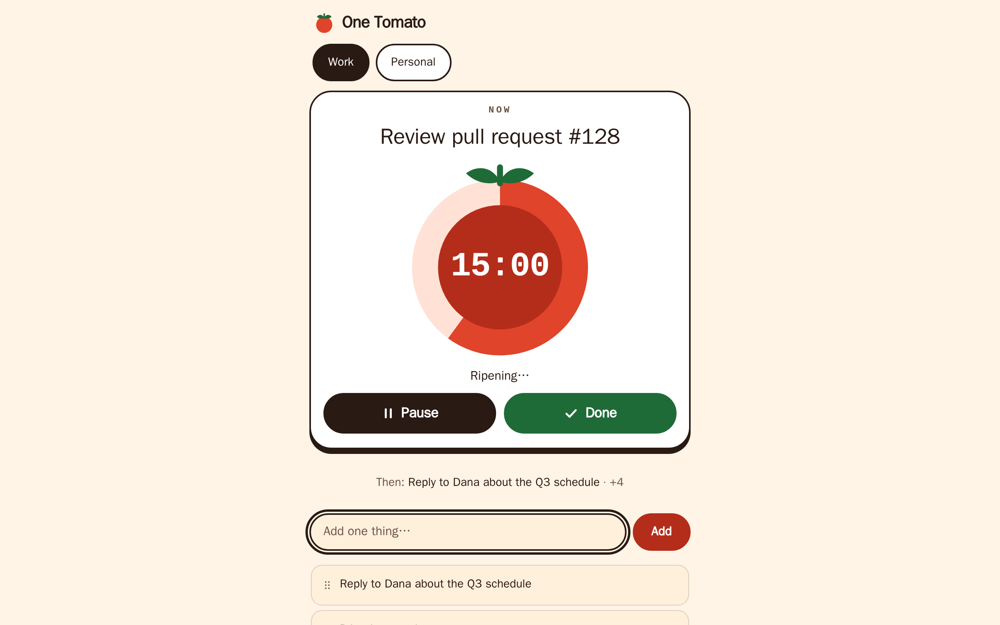
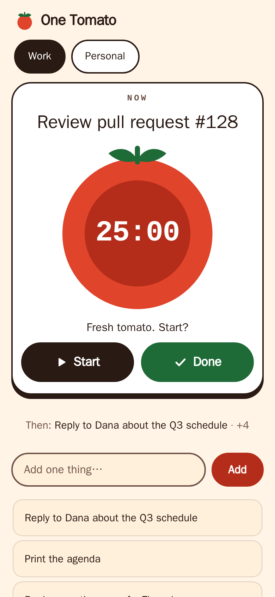
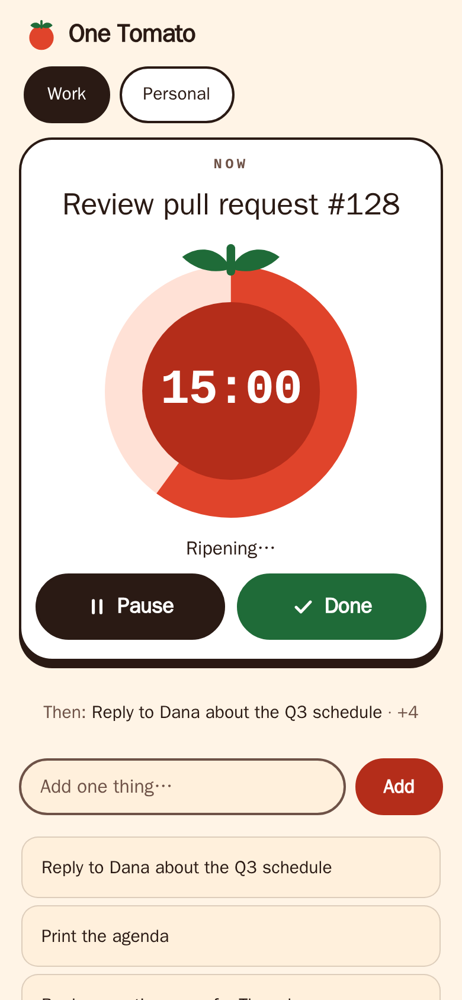
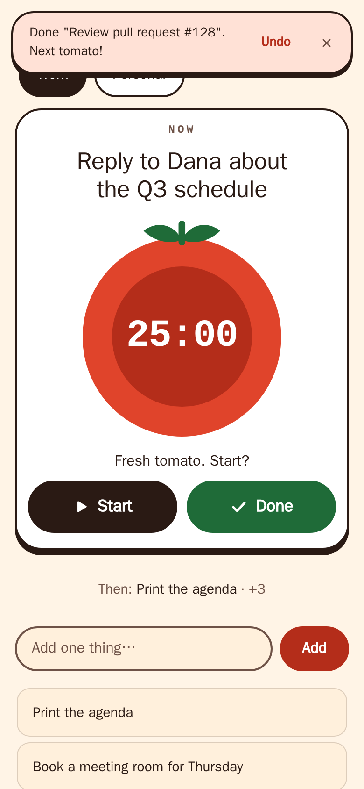

# One Tomato

A small task manager that keeps your tasks in a stack and shows one thing: the task you are doing now, inside a 25-minute tomato. It runs in the browser with plain HTML, CSS and JavaScript: no build step, no dependencies.



## How it works

- **One thing now:** the top of the stack fills the first screen: its name, a tomato dial with the time left, and two big buttons, **Start** and **Done**. Under it a single line says what comes **Then** (tap it to jump to the waiting list). A new task goes on top. The task count is kept for screen readers rather than shown as a number.
- **The tomato:** one tomato is 25 minutes, fixed. **Start** counts the time left; the red wedge shrinks, the tab title shows the clock, and under five minutes the tomato tilts. At 25:00 the timer stops (it never completes the task) and says "Ripe!": take five, then **Done**, or press **One more**. The time left is derived from the time already logged on the task, so older data with a `timeSpent` shows up as ripe tomatoes and time left. A timer left running while the page was closed is stopped when you come back, and every logged minute is kept.
- **Timer rule:** a timer belongs to the top task. When something else becomes the top (you add a task, move one, or undo), the timer of the task that got buried is paused.
- **Complete:** **Done** moves the task to the Completed list and the next one slides in. When the plate is empty you see how many you finished today and the tomatoes they ripened. Tasks can also be archived, deleted, or moved up and down with the buttons on each row. On a touch screen the row buttons stay folded away until you tap the row (one row open at a time); with a mouse they appear on hover, and with the keyboard on focus. With a mouse, drag a waiting row and the others slide aside to make room.
- **Rename:** double-click a task (or press `F2` from one of its buttons) to edit it in place. `Enter` saves, `Esc` cancels.
- **Categories:** each category (`Work` and `Personal` to start with) has its own stack, shown as tabs. Add, rename and delete them with the buttons at the bottom of the page, or double-click a tab to rename it. Drag tabs, or press `Alt` + arrow keys, to reorder them.
- **Archive and Completed:** collapsible lists per category. Restore a task to the bottom of its stack, or delete it for good.
- **Undo:** completing, archiving, restoring, deleting a task or a category, and importing show an Undo toast for a few seconds (also `Ctrl`/`Cmd` + `Z`). Only the latest action can be undone.
- **Keyboard and touch:** everything is reachable by keyboard (arrow keys switch tabs, `F2` renames), and the layout adapts to phone-sized screens. On desktop the cursor starts in the input, so you can type a task straight away; the dial changes once a second without animation, and animations are switched off when your system asks for reduced motion.

| Waiting | Focused | Just done |
| --- | --- | --- |
|  |  |  |

More: [desktop stack](docs/screenshots/stack.png), [completed list](docs/screenshots/completed.png), [empty plate](docs/screenshots/empty.png), [empty plate on a phone](docs/screenshots/mobile-empty.png).

Palette (light only, WCAG AA checked in `tests/unit/contrast.test.js`): paper `#FFF4E6`, ink `#2A1A14`, soft `#6E5247`, tomato `#E0442B` (the wedge only), tomato-deep `#B42D1A`, leaf `#1F6B38`, blush `#FFE1D6`, sun `#FFC94A`.

## Run it

Open `index.html` in a browser, or serve the folder:

```sh
npm run serve        # http://127.0.0.1:4173/  (uses node, nothing to install)
```

The Inter and JetBrains Mono fonts are loaded from Google Fonts when available; without them the system fonts are used.

## Your data

Everything stays in your browser. There is no server and no account.

- Tasks are stored as JSON in `localStorage` under the key `fileDB`: `{ tasks, completed, archived, categories, currentCategory, schemaVersion }`. A task that has been timed carries `timeSpent` (milliseconds) and, while its timer runs, `timerStartedAt`.
- **Export** downloads that data as `tasks-backup-YYYY-MM-DD.json`. **Import** checks the file first, asks before replacing your current data, and can be undone. Files larger than about 5 MB (5,242,880 characters) or with invalid tasks are rejected without changing anything. Text and category length are not limited on import, so backups from earlier versions import as they are.
- Data from earlier versions loads as is, including long tasks and category names (the input limits apply only to new tasks and categories). If only the older separate keys (`taskStack`, `completedTasks`, `archivedTasks`, `categories`, `currentCategory`) exist, they are migrated into `fileDB`. Those old keys are left in place; `fileDB` always takes precedence.
- If stored data is unreadable or partly invalid, the original text is first copied to `fileDB.backup-<timestamp>`. Readable tasks still load, unusable ones are skipped, and a message says how many. If no backup can be written, the app does not save over the original.
- Clearing site data deletes your tasks. Export a backup if they matter.

## Development

```sh
npm test                 # unit tests, Node's built-in test runner, no install needed
npm install              # once, for the browser tests and screenshots
npx playwright install chromium
npm run test:e2e         # smoke tests in headless Chromium, desktop and phone viewport
npm run screenshots      # regenerates docs/screenshots/*.png
```

Source layout: `state.js` (task and category logic), `storage.js` (`localStorage`, import and export), `ui.js` (toast, live region, dialog), `render.js` (DOM), `dnd.js` (drag and drop), `app.js` (event wiring). They are classic scripts loaded in that order by `index.html`, so the page also works from `file://`.

## License

MIT, see [LICENSE](LICENSE).
