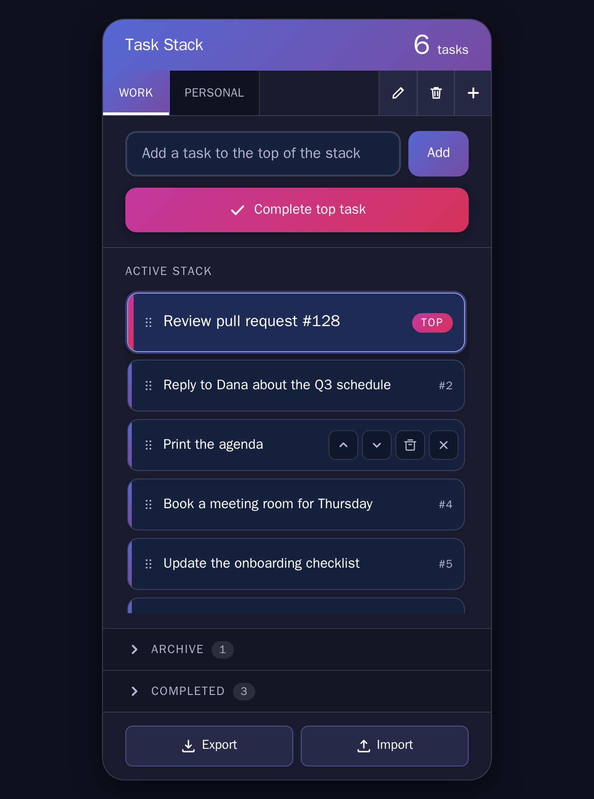
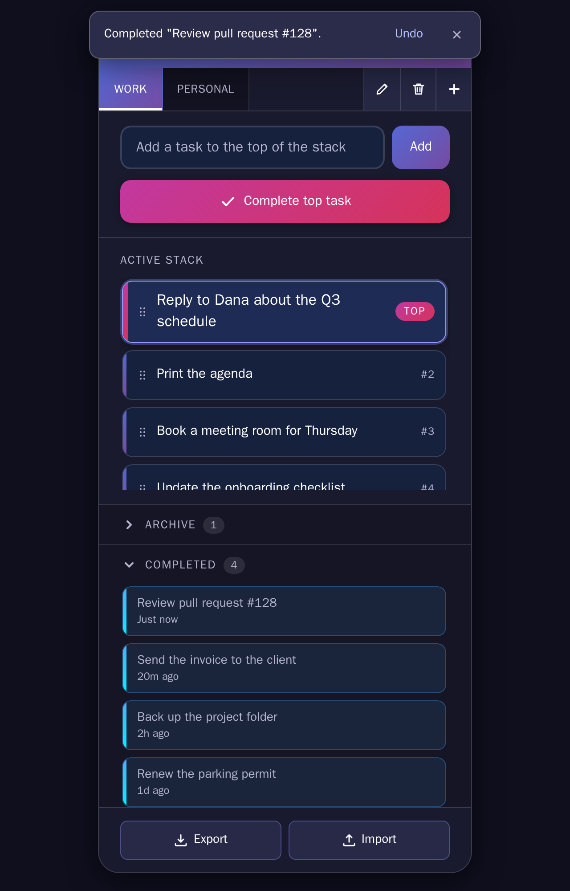

# Stack Task Organizer

A small task manager that keeps your tasks in a stack, so you work on one thing at a time. It runs in the browser with plain HTML, CSS and JavaScript: no build step, no dependencies.



## How it works

- **Stack:** a new task goes on top. The top task is highlighted and is the one to work on; the rest are numbered below it.
- **Complete:** "Complete top task" moves the top task to the Completed list. Tasks can also be archived, deleted, or moved up and down with the buttons on each row (or dragged with the mouse).
- **Categories:** each category (`Work` and `Personal` to start with) has its own stack, shown as tabs. Add, rename and delete them with the buttons next to the tabs, or double-click a tab to rename it. Drag tabs, or press `Alt` + arrow keys, to reorder them.
- **Archive and Completed:** collapsible lists per category. Restore a task to the bottom of its stack, or delete it for good.
- **Undo:** completing, archiving, restoring, deleting a task or a category, and importing show an Undo toast for a few seconds (also `Ctrl`/`Cmd` + `Z`). Only the latest action can be undone.
- **Keyboard and touch:** everything is reachable by keyboard (arrow keys switch tabs), and the layout adapts to phone-sized screens.

| Completed list with Undo | Phone |
| --- | --- |
|  |  |

An empty start screen is in [docs/screenshots/empty.png](docs/screenshots/empty.png).

## Run it

Open `index.html` in a browser, or serve the folder:

```sh
npm run serve        # http://127.0.0.1:4173/  (uses node, nothing to install)
```

The Inter font is loaded from Google Fonts when available; without it the system font is used.

## Your data

Everything stays in your browser. There is no server and no account.

- Tasks are stored as JSON in `localStorage` under the key `fileDB`: `{ tasks, completed, archived, categories, currentCategory, schemaVersion }`.
- **Export** downloads that data as `tasks-backup-YYYY-MM-DD.json`. **Import** checks the file first, asks before replacing your current data, and can be undone. Files larger than about 5 MB (5,242,880 characters) or with invalid tasks are rejected without changing anything. Text and category length are not limited on import, so backups from earlier versions import as they are.
- Data from earlier versions loads as is, including long tasks and category names (the input limits apply only to new tasks and categories). If only the older separate keys (`taskStack`, `completedTasks`, `archivedTasks`, `categories`, `currentCategory`) exist, they are migrated into `fileDB`. Those old keys are left in place; `fileDB` always takes precedence.
- If stored data is unreadable or partly invalid, the original text is first copied to `fileDB.backup-<timestamp>`. Readable tasks still load, unusable ones are skipped, and a message says how many. If no backup can be written, the app does not save over the original.
- Clearing site data deletes your tasks. Export a backup if they matter.

## Development

```sh
npm test                 # unit tests, Node's built-in test runner, no install needed
npm install              # once, for the browser tests and screenshots
npx playwright install chromium
npm run test:e2e         # smoke tests in headless Chromium, desktop and phone viewport
npm run screenshots      # regenerates docs/screenshots/*.png
```

Source layout: `state.js` (task and category logic), `storage.js` (`localStorage`, import and export), `ui.js` (toast, live region, dialog), `render.js` (DOM), `dnd.js` (drag and drop), `app.js` (event wiring). They are classic scripts loaded in that order by `index.html`, so the page also works from `file://`.

## License

MIT, see [LICENSE](LICENSE).
